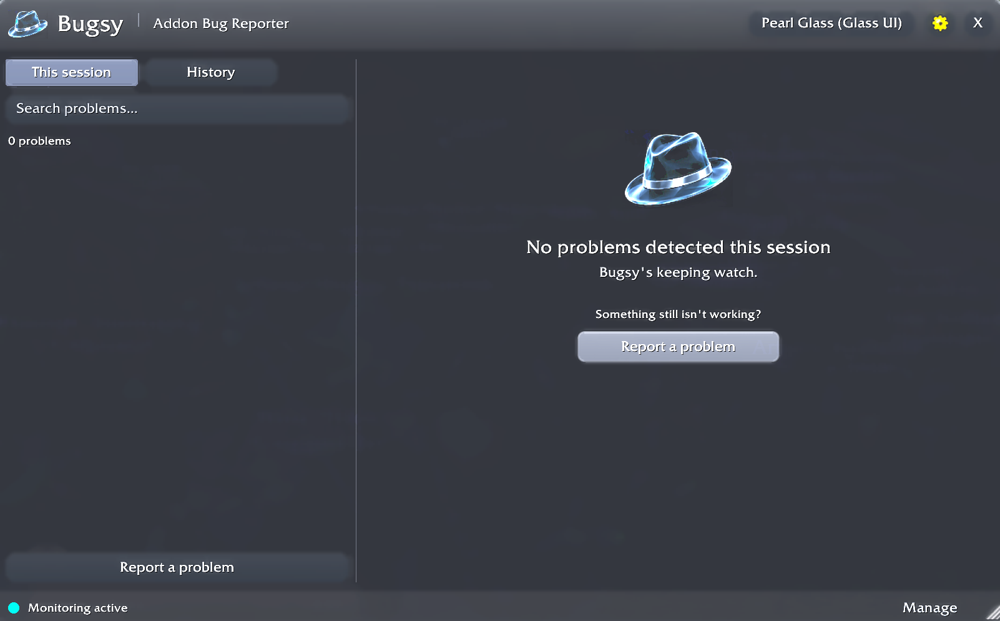

# Bugsy

A bug catcher for **World of Warcraft: Forever**. It shows you which addon is causing problems,
and gives you the diagnostics ready to paste into a bug report. It replaces your error collector
and its viewer.

## What it does

- **Catches** Lua errors, warnings and blocked actions from the moment it loads, quietly: one chat
  line and a short sound when a new problem shows up. It never opens a window by itself.
- **Shows which addon appears involved** in each problem, with the addon's icon, how often it
  happened and when. Bugsy says how sure it is ("cause unconfirmed"), and keeps what WoW named,
  the addons in the stack and its own reading apart.
- **After a patch day**, marks an addon made for an older version of the game as out of date, and
  suggests turning it off in the AddOns list until it's updated. Bugsy never turns anything off
  itself.
- **Copy for a bug report**: one click gives the diagnostics ready to paste, in Markdown for a
  GitHub issue or as a short text for a CurseForge comment (JSON too). Bugsy never sends anything
  anywhere.
- **Report a problem** that showed no error at all (an empty tab, a failed sync): a guided report
  in three steps, with a searchable addon picker and your game and addon versions added.

## Using it

`/bugsy`, the minimap button or the minimap's addon menu opens the window. The left column lists
the problems, This session or History, with a search; the right one shows the selected problem.

| Command | What it does |
|---|---|
| `/bugsy` | Open or close the window |
| `/bugsy report` | Report a problem that showed no error |
| `/bugsy status` | How Bugsy is catching errors, and anything that limits it |
| `/bugsy options` | Bugsy's page in Options > AddOns, with every setting |
| `/bugsy look forever\|pearl\|follow` | The window's look: WoW Forever, Pearl Glass, or Glass UI's |
| `/bugsy sound on\|off`, `/bugsy sound 1-6` | The alert sound, and which of six (`/bugsy sound` lists them) |
| `/bugsy notices on\|off` | The chat line for a new problem |
| `/bugsy locals on\|off` | Capture local variables with errors (off by default) |
| `/bugsy popups hide\|show` | Blizzard's popups for blocked actions and Lua warnings (hidden by default; after a reload) |
| `/bugsy front on\|off` | Catch errors ahead of another addon's error handler (on by default; after a reload) |
| `/bugsy minimap on\|off` | The minimap button |

## Good to know

- **Use it instead of your error collector and its viewer.** If another error collector is still
  enabled, Bugsy reads errors through it and inherits its limits: it doesn't keep errors whose
  message is secret, and it drops everything past 10 errors a second without counting them.
  `/bugsy status` says so. An addon that installs its own error handler is fine: Bugsy catches
  each error first and passes it on.
- **"Appears involved" is a reading, not proof.** The first addon in the stack is often the one
  that broke, but a library or a shared frame can point at the wrong one.
- **WoW pauses error reporting after a burst** (about 100 errors at once) until you reload. Bugsy
  can't see errors meanwhile; it shows that monitoring is interrupted.
- **Errors raised before Bugsy loads** can't be caught. Its folder name starts with `!` so it
  loads early.
- **Blizzard's blocked-action popup is hidden**, and with it its Disable button: turn an addon off
  in the AddOns list instead, or bring the popups back with `/bugsy popups show`.
- **Bugsy keeps up to 300 problems**, the oldest making room for new ones, and adds at most 150
  new ones a session: past that, new errors are only counted.
- **Local variables are off by default**: they can contain names and messages.

## Privacy

Everything stays on your computer. A report replaces your own character and realm names. It
can't remove other players' names that an error message may contain, so the report shows you
everything before you copy it.

## Bug reports

On [GitHub](https://github.com/Spotnick2/Bugsy/issues), or in a comment on Bugsy's CurseForge
page. Bugsy's own Copy for a bug report works for Bugsy too.

## For developers

[DESIGN.md](https://github.com/Spotnick2/Bugsy/blob/main/docs/DESIGN.md) is the architecture,
[REPORT-SCHEMA.md](https://github.com/Spotnick2/Bugsy/blob/main/docs/REPORT-SCHEMA.md) the report
format, [LIBRARY.md](https://github.com/Spotnick2/Bugsy/blob/main/docs/LIBRARY.md) the planned
library for authors, and [FOREVER-PROBE.md](https://github.com/Spotnick2/Bugsy/blob/main/docs/FOREVER-PROBE.md)
what was measured in game. Tests: `pwsh tests\run.ps1`.

## Licence

MIT. Bugsy bundles no library: when another addon has loaded LibGlass, LibDataBroker or
LibDBIcon, it uses that copy.
